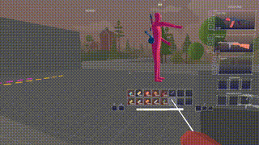
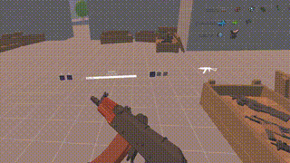
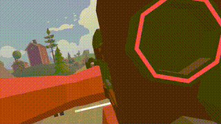
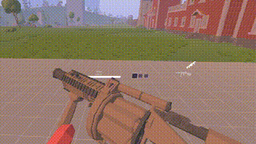
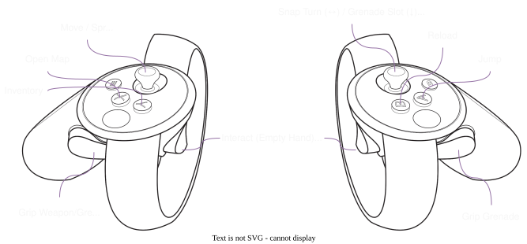

# TABG VR

> [!WARNING]
> (November 2026): Due to prolonged inactivity on this project (*cough cough 2 years*), you may see significant issues related to infra (e.g. CI), and shaders. I will be working out the kinks and pushing some updates soon.

[ENG | [РУС](README_RU.md)]

[//]: # (![Shooting Test]&#40;img/demos/ak_shoot_old.gif&#41;)

## Installation
[Refer to the Setup Guide for installation instructions.](SETUP.md)

[Alternatively, refer to the Compiling Guide for compilation instructions.](COMPILING.md)

## Controller Layout

## On LLM use and artificial intelligence

The majority of this project was made by a depressed 14-year-old late at night in 2024 to cope with her inner demons. Any AI use has been restricted to just maths or slight IL problems (as least from what I can recall now), such as understanding quaternions and fixing some assembly patches. No agents were used.

**I hate the hype of people using AI agents to mod games into VR. It's sloppy and goes against my values as a developer.**